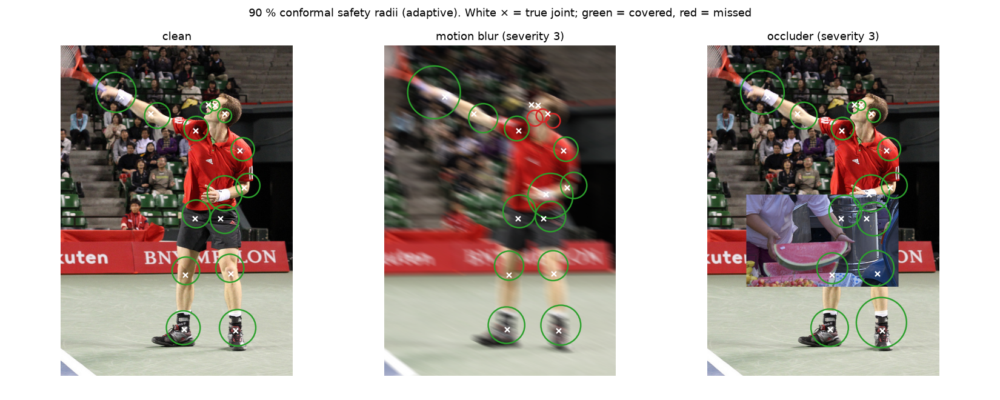
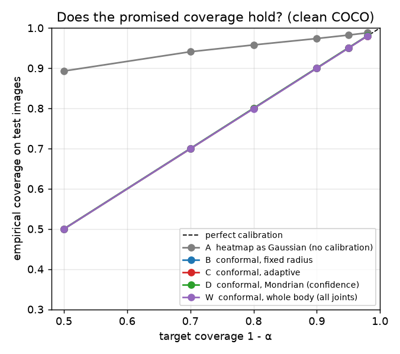
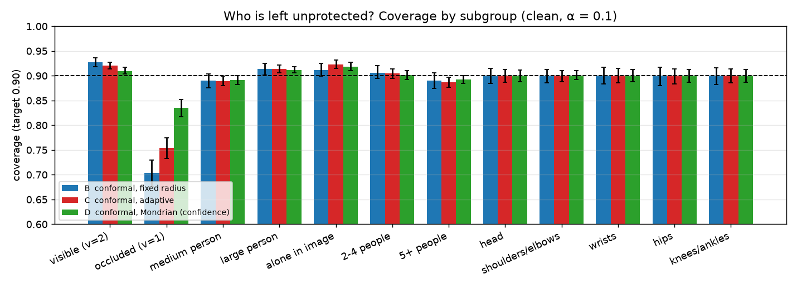
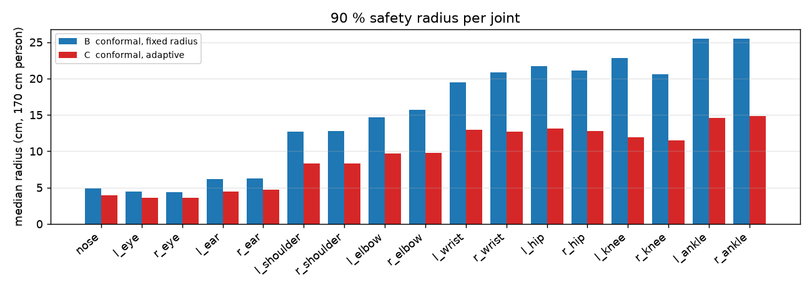
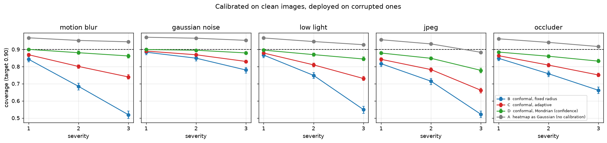

# How close can a robot get? Conformal safety margins for human keypoints

[](https://github.com/HessamKaveh/pose-safety-margins/actions/workflows/ci.yml)   [](LICENSE)

A robot sharing a workspace with people needs more than a skeleton: it needs to know **how far from each predicted joint the real joint could be**. This study wraps a 2D human-pose estimator with **conformal prediction**, which turns every predicted joint into a safety disc with a statistical guarantee ("the true joint lies inside with probability ≥ 90 %"). It then tests where that guarantee holds, where it quietly fails, and what it costs in margin size.

<p align="center"></p>

*90 % safety discs from adaptive conformal prediction on an unseen COCO image. Under heavy motion blur the discs grow automatically. Red = the true joint (×) fell outside its disc.*

---

## Key findings

All numbers are on COCO val2017 people the model never saw in training (6,352 people, 68,215 labelled joints, 2,346 images). Calibration and test sets are random 50/50 splits **by image**, repeated 200 times; brackets are 2.5–97.5 % ranges over repeats. Distances are converted to centimetres for a 170 cm person, for illustration only.

| # | Question | Finding |
|---|---|---|
| 1 | **Can the model's own uncertainty be trusted?** | **No, it is miscalibrated.** Reading the heatmap as a Gaussian gives **97.4 %** coverage when 90 % is asked and 89 % when 50 % is asked: much too wide at most levels, and not adjustable. |
| 2 | **Does conformal prediction deliver the promised coverage?** | **Yes, on average.** All conformal variants hit 90.0 % [89.1, 90.8] and 95.0 % exactly. The *adaptive* variant does it with a **39 % smaller median disc** than a fixed radius (9.6 vs 15.7 cm at 90 %), and 13.1 vs 29.5 cm at 95 %. |
| 3 | **"90 % per joint" ≠ "90 % of people are safe."** | With per-joint discs, **only 46–56 % of people have *all* their joints inside** their discs. A **whole-body** conformal score (max over joints) restores 90.0 % [88.3, 91.4] person-level coverage, at a median disc of 18 cm. This is the guarantee a safety controller actually needs. |
| 4 | **Who is left unprotected?** | **Occluded joints.** At 90 % overall, a fixed radius covers only **70 %** [68, 73] of occluded joints (visible: 93 %). Adaptive discs reach 75 %, and **Mondrian (confidence-grouped) conformal 84 %**. Person size and crowd size matter little (89–92 %). Coverage is flat across joints, including the **wrists**, the joints closest to a robot (90 % disc: 19.5 cm fixed → 12.9 cm adaptive → 9.3 cm Mondrian). |
| 5 | **Does the guarantee survive a dirty camera?** | **No. Every method breaks under shift, but not equally.** Calibrated on clean images and deployed on heavy motion blur, coverage collapses to **52 %** with a fixed radius, **74 %** adaptive and **86 %** Mondrian. Low light: 55 / 73 / 84 %. JPEG: 52 / 66 / 78 %. The heatmap-aware methods partly *notice* the shift and widen their discs (Mondrian median 7.6 → 36 cm under blur). A fixed radius cannot. |
| 6 | **Does calibrating on easy scenes transfer to crowds?** | **Mostly, with a small loss.** Calibrated only on people alone in their image and tested in crowds of 5+, per-joint coverage drops to 86–88 % and whole-body coverage to 84 % (target 90 %). |

**Practical takeaway for HRC:**
- Use **whole-body, uncertainty-adaptive** conformal margins rather than a fixed safety distance.
- **Recalibrate** under the robot's actual camera conditions, because a guarantee earned on clean images does not transfer to blur, low light or compression.

---

## 1. Setup

| | |
|---|---|
| Pose model | SimpleBaseline ResNet-50, 256×192, trained on COCO train2017 in [human-pose-estimation](https://github.com/HessamKaveh/human-pose-estimation) (68.7 AP on val2017, reproduced here exactly) |
| Boxes | ground-truth person boxes (isolates keypoint uncertainty from detection errors) |
| Data | COCO val2017: every person with ≥ 1 labelled keypoint; joints with `v = 0` (not labelled) are excluded |
| Error | Euclidean distance (px) between predicted and true joint; scale-normalised by person box height `h` where needed |
| Heatmap spread σ | second moment of the flip-averaged heatmap around its peak, minus the σ = 2 target blur, mapped to image pixels |
| Splits | 50/50 calibration/test by **image**, 200 random repeats |

## 2. Methods

| | Method | Score / radius | Guarantee |
|---|---|---|---|
| A | Heatmap as Gaussian | r = σ·√(−2 ln α) | none (taken at face value) |
| B | Conformal, fixed radius | score e/h per joint → r = q·h | marginal, per joint |
| C | Conformal, adaptive ("normalised") | score e/σ per joint → r = q·σ | marginal, per joint |
| D | Conformal, Mondrian | as C, separate q per joint × confidence tercile | per joint and per confidence group |
| W | Conformal, whole body | score max_j e_j/σ_j per person → r_j = q·σ_j | **all joints of a person at once** |

q is the finite-sample conformal quantile, the ⌈(n+1)(1−α)⌉-th smallest calibration score (`src/conformal.py`).

## 3. Results

### Calibration (clean images)

<p align="center"></p>

| Method (α = 0.1) | Joint coverage | **Person coverage (all joints)** | Median disc | Mean disc |
|---|---|---|---|---|
| A heatmap as Gaussian | 97.4 % | 85.2 % | 16.1 cm | 23.1 cm |
| B conformal, fixed | 90.0 % | 55.7 % | 15.7 cm | 15.1 cm |
| C conformal, adaptive | 90.0 % | 49.5 % | **9.6 cm** | **13.3 cm** |
| D conformal, Mondrian | 90.0 % | 46.1 % | **7.6 cm** | 14.9 cm |
| **W conformal, whole body** | 98.1 % | **90.0 %** | 18.1 cm | 25.8 cm |

*Mean discs are capped at 2 × person height.* Mondrian has the smallest *typical* disc but a heavier tail: it spends its margin on the low-confidence joints.

### Who is left unprotected?

<p align="center"></p>

<p align="center"></p>

The face joints need discs of only 4–6 cm. Wrists, hips, knees and ankles need 12–15 cm (adaptive) or 20–25 cm (fixed). Ankles and wrists are the least precisely localised joints, and the wrists are the ones most likely to be near a robot.

### Distribution shift: calibrated clean, deployed corrupted

<p align="center"></p>

Five corruptions a workcell camera meets (motion blur, sensor noise, low light with shot noise, JPEG compression from a network stream, an object occluding 10–40 % of the person), each at 3 severities, applied to the full image before cropping. At severity 3:

| Corruption | Median error (clean 3.3 cm) | B fixed | C adaptive | D Mondrian | W whole body (person cov.) |
|---|---|---|---|---|---|
| motion blur | 12.1 cm | 51.9 % | 73.9 % | **86.2 %** | 80.9 % |
| low light | 10.8 cm | 54.9 % | 73.0 % | **84.4 %** | 76.4 % |
| JPEG (q = 5) | 12.2 cm | 52.2 % | 66.2 % | **77.8 %** | 63.9 % |
| occluder (40 %) | 7.1 cm | 66.2 % | 75.1 % | **83.2 %** | 72.6 % |
| Gaussian noise | 4.8 cm | 78.0 % | 83.0 % | **87.9 %** | 82.6 % |

All conformal guarantees assume calibration and deployment data are exchangeable, and this table shows how fast that assumption fails. The ranking B < C < D is stable across every corruption and severity: the more a method lets the model's own uncertainty shape the disc, the more of the shift it absorbs. The heatmap Gaussian (A) stays above 88 %, but only because it is over-wide everywhere.

## 4. Limitations

- **2D image-plane margins.** A robot needs 3D margins. The centimetre values here are an illustration (person height = 170 cm), not metric depth. The natural next step is to lift the discs with an RGB-D camera.
- **Ground-truth boxes.** Detection errors (missed or misplaced people) are not included. A missed person has no disc at all.
- **Synthetic corruptions.** They approximate, but do not replace, data from a real workcell camera.
- **Marginal guarantees.** Even Mondrian conformal prediction guarantees coverage only within the groups it conditions on (here: confidence terciles), not for every person.

## 5. Reproduce

```bash
pip install -r requirements.txt
export COCO_ROOT=/path/to/coco                   # val2017/ and annotations/person_keypoints_val2017.json
# model weights: train with github.com/HessamKaveh/human-pose-estimation, then
ln -s /path/to/simplebaseline_resnet50.pt cache/simplebaseline_resnet50.pt
python src/infer.py        # clean + 5 corruptions x 3 severities -> cache/outputs_*.npz  (~10 min, 4 GB GPU)
python src/analyze.py      # all experiments, results/results.json, results/figures/       (~4 min, CPU)
```

```
src/infer.py        pose inference, heatmap spread, corruptions applied before cropping
src/corruptions.py  motion blur, noise, low light, JPEG, occluder (seeded, 3 severities)
src/conformal.py    methods A, B, C, D and W
src/analyze.py      repeated image-level splits, all experiments and figures
```

## References

- Angelopoulos & Bates, *A Gentle Introduction to Conformal Prediction and Distribution-Free Uncertainty Quantification*, 2021.
- Papadopoulos et al., *Normalized nonconformity measures for regression conformal prediction*, 2008 (adaptive scores).
- Vovk et al., *Algorithmic Learning in a Random World*, 2005 (Mondrian conformal prediction).
- Xiao et al., *Simple Baselines for Human Pose Estimation and Tracking*, ECCV 2018.
- Hendrycks & Dietterich, *Benchmarking Neural Network Robustness to Common Corruptions and Perturbations*, ICLR 2019.

## Author
Hessam Kaveh — Research Fellow, Italian Institute of Technology (IIT)

## Citation

If you use this code, please cite it (metadata in [`CITATION.cff`](CITATION.cff)):

```bibtex
@software{kaveh2026_pose_safety_margins,
  author  = {Kaveh, Hessam},
  title   = {How close can a robot get? Conformal safety margins for human keypoints},
  year    = {2026},
  version = {1.0.0},
  url     = {https://github.com/HessamKaveh/pose-safety-margins},
  license = {MIT}
}
```

## License

Released under the [MIT License](LICENSE).
